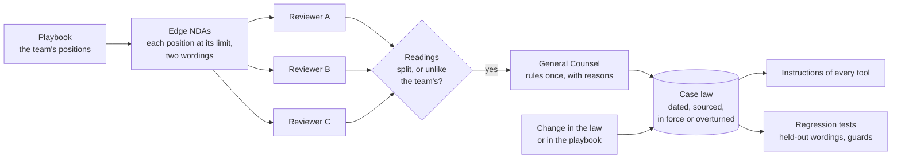

# tamyiz

**A legal team's own case law, for every AI tool it uses.**
Every AI reviewer — Claude for Legal's agents, a legal-tech product, a model with a good prompt —
reads the team's playbook its own way. On the clear points they agree with each other and with the
team. On the edges, where the playbook does not say enough, they still agree with each other — and
can all be wrong about what the General Counsel meant. tamyiz finds those edges, puts each one to the
General Counsel once, turns the answer into a ruling that binds every tool, and checks that they all
follow it, today and after the next model update.

In Arabic, *tamyīz* (تمييز) is discernment. It is also the name of the court of cassation in Dubai,
Kuwait and Jordan: the court whose rulings make the law read the same way everywhere.

[Français](README.fr.md) · [العربية](README.ar.md)

---

## What it found

**Twenty-five NDAs at the edge of a Dubai company's playbook**, read by four AI reviewers: Claude
Opus 5.5 alone; Claude Opus 5.5 running Claude for Legal's NDA Triager, set up for the team as its
interview would set it up; Claude Sonnet 5.5 alone; Claude Haiku 5.5 as an agent with
[courtproof](https://github.com/Tradilyes/courtproof)'s checks. Ten questions of interpretation in two
wordings each (one reviewed by the General Counsel, one held out), and five controls, three of which
guard against a ruling reaching too far. Keys were committed before the first run, rulings before the
runs that test them ([full results](suites/nda-boundary/RESULTS.md)).

1. **The four reviewers read all ten edge clauses the same way.** Eight as the General Counsel meant.
   Two otherwise, all four together: an NDA of three years that renews unless a party gives notice
   went to counsel review (term too long), and the usual protection of trade secrets "for as long as
   they remain trade secrets" went to full legal review (perpetual). Comparing the tools with each
   other shows nothing; only the General Counsel's review of the edges does.

2. **Two rulings fixed every tool at once**, the official agent included, because a ruling travels as
   text into each tool's instructions:

   | Reviewer | Held-out NDAs, before | after two rulings | Controls and guards, before | after |
   |---|---|---|---|---|
   | Claude Opus 5.5 alone | 8 / 10 | **10 / 10** | 5 / 5 | 5 / 5 |
   | Claude Opus 5.5 running Claude for Legal's NDA Triager | 8 / 10 | **10 / 10** | 5 / 5 | 5 / 5 |
   | Claude Sonnet 5.5 alone | 8 / 10 | **10 / 10** | 4 / 5 | 5 / 5 |
   | Claude Haiku 5.5 + courtproof, as an agent | 8 / 10 | **10 / 10** | 5 / 5 | 5 / 5 |

3. **The rulings did not reach further than they were written to.** A five-year term that renews,
   a renewal nobody can stop, and "highly confidential" information protected forever stayed flagged
   for every reviewer. The one real disagreement of the study — on the renewal nobody can stop, one
   reviewer also saw a perpetual obligation — disappeared under the first ruling, which says what to
   do with it.

The cost per NDA barely moved: the two rulings add under two hundred words to a prompt.

## How it works



- **A ruling** answers one question, with its reasons, the playbook positions it interprets, the legal
  facts it rests on, and a status ([format](spec/caselaw.schema.json)). It is never edited: a later
  ruling overturns it, and the record keeps both.
- **Compiled into every tool**: `compileInstructions` gives the rulings in force as text to put under
  the playbook — in a Claude for Legal practice profile, a custom assistant, a legal-tech workflow.
  The team's interpretation stays the team's, whichever vendor it uses next year.
- **Checked**: each ruling comes with the wording it was decided on, a held-out wording and guards;
  the suite runs again after every model or tool update.
- **Kept current**: `affectedBy` lists the rulings to review when a playbook position or a legal fact
  changes (with [compliance-atlas](https://github.com/Tradilyes/compliance-atlas)'s dated facts).

## Use it

**In Claude, as a page the team shares.** [`desk/`](desk/) builds the *Tamyiz NDA Desk*: Claude
reviews an NDA in English and Arabic, with courtproof's checks as its tools (the two versions, every
quote, the routing); points the playbook leaves open go to the General Counsel in one click; each
ruling binds every later review; edge probes show how Claude reads the playbook today; the case law
copies into any other tool's instructions. Claude runs on each viewer's own account.

```
node desk/build.mjs        # needs a courtproof checkout beside this one
# then publish desk/artifact.html as an artifact in Claude
```

**From the command line, with any reviewer** (Claude Code runs the reviewers here):

```
node suites/nda-boundary/run.mjs --arm opus-plain --mode plain --model opus --effort high --condition before --split all
node suites/nda-boundary/run.mjs --arm opus-cfl --mode cfl --model opus --effort high --condition after --split test
node suites/nda-boundary/run.mjs --report
node suites/nda-boundary/run.mjs --show-system cfl --condition after   # what Claude for Legal's agent receives
```

**In code**: `engine/caselaw.mjs` (validate, rulings in force on a date, compile, dependencies,
overturn) and `engine/mine.mjs` (readings of several reviewers, codes in dispute, agreement). No
dependencies.

## What this does not show

- One suite: NDAs, in English, twenty-five documents, one run per reviewer and condition. The
  documents, the keys and the rulings are the author's, for a fictional company; another General
  Counsel could rule the other way. The method does not decide what is right: it makes the team's
  choice explicit, binding and tested.
- Four reviewers, all on Claude models. Products of other vendors were not tested; more independent
  reviewers surface more disagreements.
- Edge NDAs are written by hand. Generating them from any playbook, in Arabic and French as well, is
  the next step.

## Next

- Edge NDAs generated from a playbook's positions, in English, Arabic and French — including the
  questions only a bilingual contract raises (which version prevails, a term defined in one language).
- A vendor-review suite from compliance-atlas, where the first two questions are already known: does
  a no-training promise cover the outputs; does a host's certification cover the vendor.
- Rulings that rest on a legal fact, flagged when compliance-atlas records a change in that fact.
- The case law as a resource any MCP client can read.

## Related

- [courtproof](https://github.com/Tradilyes/courtproof): the checks the desk gives Claude as tools.
- [compliance-atlas](https://github.com/Tradilyes/compliance-atlas): dated, sourced Gulf and EU data-protection facts.

---

Designed by **ILYES M. TRAD**, researcher in law and artificial intelligence. Written with the help of
an AI assistant (Claude); every figure on this page comes from the code and answers in this repository.
MIT licence; the Claude for Legal files in `baseline/` keep their Apache 2.0 licence.
